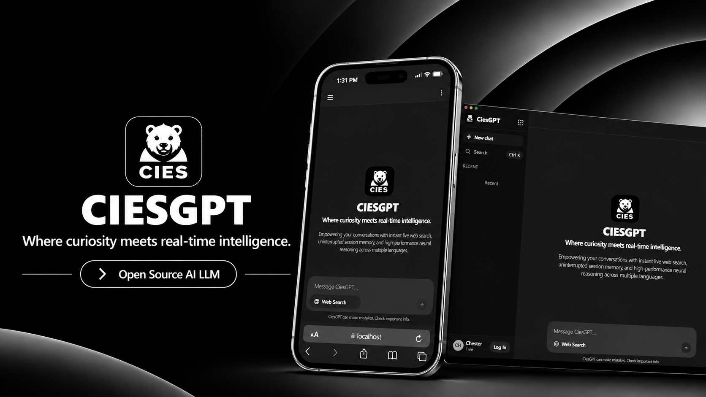

<div align="center">



# CIESGPT

[](https://github.com/Chesster06/cies-gpt-llm)
[](https://github.com/Chesster06/cies-gpt-llm)
[](https://golang.org/)
[](https://vitejs.dev/)

**CIESGPT** is a self-hosted, web-based conversational AI platform powered by **CIES-1.5B**—a custom in-house neural model developed by **CSDevelopment** and fine-tuned via **LoRA** on the **Qwen-1.5B** architecture. Built with real-time SSE token streaming, local SQLite persistence, and a high-throughput Go backend.

</div>

---

## Service Ports

All services operate on clean, consecutive local ports:

| Service                                     | Port   | Local URL             |
| ------------------------------------------- | ------ | --------------------- |
| **Frontend Web UI** (React + Vite)          | `8082` | http://localhost:8082 |
| **Backend API** (Go + SQLite)               | `8080` | http://localhost:8080 |
| **Model Engine** (Qwen 1.5B LoRA + PyTorch) | `8081` | http://localhost:8081 |

---

## Prerequisites

- **Python 3.10+** (with NVIDIA CUDA support if using GPU acceleration)
- **Go 1.22+**
- **Node.js 18+** & **npm**

---

## Installation & Getting Started

### 1. Clone the Repository

```bash
git clone https://github.com/Chesster06/cies-gpt-llm.git
cd cies-gpt-llm
```

### 2. Install Dependencies

```bash
# Python Model Server
cd model-llm && pip install torch transformers peft accelerate safetensors sentencepiece duckduckgo_search && cd ..

# Frontend Web Application
cd frontend && npm install && cd ..
```

### 3. Environment Configuration

Copy the example environment file:

```bash
cp .env.example .env
```

_(SQLite database initializes automatically under `backend/data/cies.db` without extra configuration.)_

### 4. Launch Services

#### Option A: One-Click Launch (Windows)

```cmd
start.bat
```

#### Option B: One-Click Launch (Linux / macOS)

```bash
chmod +x start.sh
./start.sh
```

#### Option C: Manual Launch (3 Independent Terminals)

```bash
# Terminal 1: Model Engine (Port 8081)
cd model-llm && python reassemble.py && python server.py

# Terminal 2: Backend API (Port 8080)
cd backend && go run ./cmd/server

# Terminal 3: Frontend Web UI (Port 8082)
cd frontend && npm run dev
```

Open your web browser and navigate to: **[http://localhost:8082](http://localhost:8082)**

---

## Project Structure

```text
├── assets/                             # Visual branding and cover preview assets
│   └── CIES.png                        # Architecture preview banner
├── backend/                            # Go high-throughput API gateway module
│   ├── cmd/server/                     # Server application entrypoint
│   │   └── main.go                     # Service initialization, routing, and lifecycle
│   ├── internal/                       # Internal application domain logic
│   │   ├── config/                     # Configuration and environment loader
│   │   ├── dto/                        # Request and response Data Transfer Objects
│   │   ├── handler/                    # REST HTTP route handlers (auth, chat, conversations)
│   │   ├── middleware/                 # CORS, auth verification, and guest context
│   │   ├── model/                      # Domain entities (User, Conversation, Message)
│   │   ├── provider/cies/              # In-house CIES model client and SSE streaming proxy
│   │   ├── repository/                 # Native SQLite database repositories
│   │   ├── router/                     # Chi v5 router configuration and endpoints
│   │   └── service/                    # Business services (auth, chat, message storage)
│   ├── data/                           # Local database storage directory
│   │   └── cies.db                     # Active SQLite database file
│   ├── go.mod                          # Go module dependencies
│   └── server.exe                      # Compiled Windows backend binary
├── frontend/                           # React 18 single-page webchat interface
│   ├── src/                            # Application frontend source
│   │   ├── components/                 # Reusable UI components (chat, sidebar, modals)
│   │   ├── pages/                      # Page views (ChatPage, LoginPage, SettingsPage)
│   │   ├── services/                   # API HTTP client and streaming consumers
│   │   ├── stores/                     # Zustand state management (`chatStore.ts`)
│   │   ├── types/                      # TypeScript type definitions and interfaces
│   │   ├── App.tsx                     # Core view routing and layout container
│   │   └── main.tsx                    # React DOM client entrypoint
│   ├── package.json                    # Node dependencies & npm scripts
│   └── vite.config.ts                  # Vite development server and build configuration
├── model-llm/                          # Python neural model & inference engine
│   ├── weights/                        # Model weights, configuration, and tokenizers
│   │   ├── config.json                 # Architecture configuration
│   │   ├── tokenizer.json              # Multilingual BPE tokenizer vocabulary
│   │   ├── chat_template.jinja         # ChatML prompt formatting template
│   │   └── model.safetensors.part*     # 31 split weights chunks (<95MB each for GitHub)
│   ├── reassemble.py                   # Automatic cross-platform weights reassembly script
│   └── server.py                       # Standalone SSE streaming inference HTTP server
├── docker-compose.yml                  # Multi-container orchestration specification
├── start.bat                           # One-click Windows development orchestrator
├── start.sh                            # One-click Linux/macOS development orchestrator
└── README.md                           # Documentation and quick start manual
```

---

## Author

- **Developer**: [Chesster (Chesster06)](https://github.com/Chesster06)
- **Organization**: **CSDevelopment**
